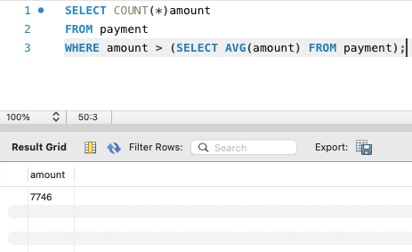

# Chapter 7: Subqueries

## Summary

This assignment demonstrates the use of subqueries in MySQL using the Sakila database. It covers different types of subqueries and how they can be used to retrieve, filter, and organize data from multiple tables.

The assignment includes queries using the WHERE, SELECT, and FROM clauses, along with operators such as IN, ALL, and NOT EXISTS. It also demonstrates correlated subqueries, aggregate functions, and rewriting subqueries using JOIN statements.

The queries use the customer and payment tables to perform different database operations and retrieve the required results.

## Author

- **Bilal**
  - GitHub Profile: [(https://github.com/mbilalcyber/MySQL_Chapter7.git)]

## New Concepts Used

The following concepts were covered and practiced in this assignment:

1. Subqueries in the WHERE clause.
2. Single-value subqueries.
3. IN operator with subqueries.
4. ALL operator with subqueries.
5. Correlated subqueries.
6. AVG() aggregate function.
7. MAX() aggregate function.
8. COUNT() aggregate function.
9. NOT EXISTS operator.
10. Subqueries in the SELECT clause.
11. Subqueries in the FROM clause.
12. INNER JOIN.
13. LEFT JOIN.
14. GROUP BY and ORDER BY.
15. LIMIT clause.
16. Using subqueries with aggregate functions.

## Screenshots and Testing

All query output screenshots are stored in the `assets` folder.

The screenshots show the results returned by the SQL queries after executing them in MySQL Workbench.

### Screenshot Files

The following screenshots are included in the assets folder:

- `1.png` – Query 2.A
- `2.png`
- `3.png`
- `4.png`
- `5.png`
- `6.png`
- `8.png`
- `9.png`
- `10.png`
- `11.png`
- `12.png`
- `13.png`
- `14.png`

### Query Output

The screenshots provide visual evidence of the query execution and returned results.

Example:



All screenshots are available in the repository under the `assets` directory.

## Repository Structure

```text
MySQL_Chapter7/
│
├── assets/
│   ├── 1.png
│   ├── 2.png
│   ├── 3.png
│   ├── 4.png
│   ├── 5.png
│   ├── 6.png
│   ├── 8.png
│   ├── 9.png
│   ├── 10.png
│   ├── 11.png
│   ├── 12.png
│   ├── 13.png
│   └── 14.png
│
├── Chapter7.sql
│
└── README.md
```

## Database

**Database Used:** Sakila

**Language:** MySQL

**Software:** MySQL Workbench

---

